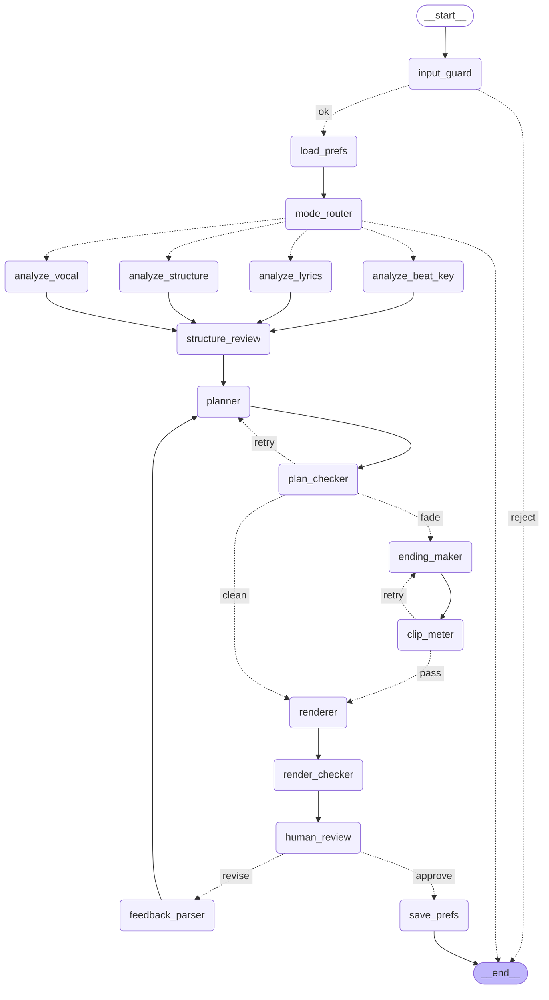

# 에이전트 그래프 (골격)

`uv run main.py --draw` 로 터미널에서 ASCII 그래프를 볼 수 있다. ASCII 출력은 되돌아가는 간선(재계획 루프 등)이 잘 안 보여서 아래 Mermaid 그림을 같이 둔다.
지금 노드는 모두 가짜 값을 돌려주는 빈 함수다. 구조는 컨텍스트 문서 6절 "제안" 초안을 옮긴 것이고 확정이 아니다.

## 루프와 분기

| 라우터 | 위치 | 라벨 | 설명 |
|---|---|---|---|
| route_guard | input_guard 뒤 | ok / reject | 가드레일 통과 못 하면 종료 |
| route_mode | mode_router 뒤 | 분석 노드 4개 / 종료 | 재구성이면 4개 병렬 실행, 메들리(확장)는 아직 종료 |
| route_plan | plan_checker 뒤 | retry / fade / clean | 검증 실패면 재계획(최대 3회, 이후 코러스 중심 단순안). 통과하면 페이드아웃 여부로 분기 |
| route_clip | clip_meter 뒤 | retry / pass | 엔딩 클립 측정 실패면 재생성(최대 3회, 이후 잔향 마무리) |
| route_review | human_review 뒤 | approve / revise | 승인이면 취향 저장, 수정이면 피드백 해석 후 재계획 |

## 수업 코드 스타일과 다른 점

- 분석 4개 병렬 실행을 위해 `route_mode`가 라벨 하나 대신 노드 이름 리스트를 돌려준다. LangGraph에서 조건 분기 함수가 리스트를 돌려주면 그 노드들이 동시에 실행된다.
